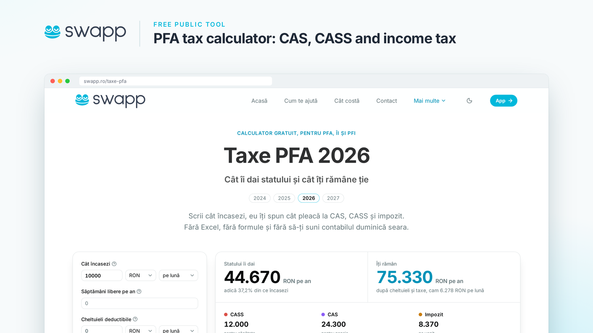

# Calculatorul s-a mutat pe [swapp.ro/taxe-pfa](https://swapp.ro/taxe-pfa)

Calculatorul rapid de taxe pe care l-am publicat aici în 2022 a crescut și face acum parte din [swapp.ro](https://swapp.ro), pentru PFA, ÎI și PFI.

Scrii cât încasezi, eu îți spun cât pleacă la CAS, CASS și impozit.

**[Calculează-ți taxele pe swapp.ro/taxe-pfa](https://swapp.ro/taxe-pfa)**

---

**English:** this quick tax calculator for Romanian freelancers now lives at [swapp.ro/taxe-pfa](https://swapp.ro/taxe-pfa), part of [swapp.ro](https://swapp.ro), invoicing and single-entry accounting for Romanian sole traders. The old address redirects there. The original SvelteKit source remains in this repository's history, tagged [`sveltekit-calculator`](https://github.com/icflorescu/quick-romanian-freelance-tax-calculator/tree/sveltekit-calculator), under the [ISC License](LICENSE).
